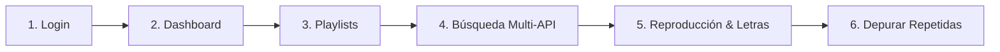

# 🎵 Gavify SaaS — Tu Música, Perfectamente Organizada

> **Gavify** es una plataforma SaaS de gestión musical inteligente que unifica catálogos de **Spotify**, **YouTube Music** y **YouTube** en un único lugar, permitiendo buscar canciones en tiempo real, escuchar la pista original completa con video y letras, organizar playlists públicas/privadas y **detectar y depurar canciones duplicadas** en un solo clic.

---

## 🚀 ¿Qué problema resuelve Gavify?

Los usuarios activos de servicios de streaming acumulan música en múltiples aplicaciones sin un punto de control centralizado. Al importar listas compartidas o guardar canciones rápidamente:
- Se generan **canciones repetidas** dentro de la misma lista, provocando molestos loops auditivos.
- Se pierde tiempo intentando depurar bibliotecas extensas de forma manual.
- Las plataformas oficiales no ofrecen un reproductor conjunto que combine la búsqueda de Spotify con el catálogo completo de video y audio de YouTube Music.

**Gavify** resuelve esta fragmentación ofreciendo una interfaz moderna, oscura y fluida que centraliza la búsqueda, la reproducción y la optimización de playlists.

---

## ✨ Características Principales

### 🔍 1. Búsqueda Multi-API en Tiempo Real
- Conexión simultánea con **Spotify Web API**, **YouTube Music API** y **YouTube Data API v3**.
- Búsqueda reactiva mientras escribes (por título, artista o álbum).
- Filtro por plataforma: Spotify, `YT Music` y YouTube.
- Agregado instantáneo a cualquiera de tus playlists con el botón `+` (sin necesidad de subir archivos de audio a mano).

### 🎧 2. Reproductor Multimedia Completo (Footer Player)
- Reproductor fijo de extremo a extremo en la parte inferior de la pantalla.
- **Audio original completo:** Conexión con streams oficiales para escuchar la pista entera (sin previews truncadas de 30 segundos).
- Controles avanzados: avance, retroceso, barra de progreso interactiva, volumen con slider redondeado y modo aleatorio (*shuffle*).
- **Visor de Video Expandible (icono de ojo):** Abre el videoclip oficial en ventana flotante o pantalla completa sin tapar la barra de navegación ni el reproductor.
- **Letras Sincronizadas (icono de texto):** Despliega las letras completas de la pista en reproducción.

### 📋 3. Gestión de Playlists al Estilo Spotify & YouTube Music
- Cuadrícula responsiva de 4 columnas adaptable a cualquier resolución de pantalla.
- Selector de visibilidad con un switch moderno: **Pública** o **Privada**.
- Visualización de carátulas combinadas, duración acumulada y número de canciones.
- Barra lateral estática que mantiene siempre a mano las **playlists usadas recientemente**.

### 🧹 4. Motor de Detección y Purga de Canciones Repetidas
- Auditoría automática de canciones duplicadas dentro de la misma playlist activa.
- Identificación por identificador único (ISRC) o coincidencia de título y artista.
- **Depuración segura:** Permite eliminar las copias redundantes con un solo clic, solicitando confirmación previa obligatoria antes de modificar la base de datos.

### 📊 5. Gráfico de Ritmo de Escucha y Estadísticas Semanales
- Gráfico de actividad semanal con degradados suaves diseñados para evitar la fatiga visual.
- Métrica de canciones escuchadas por día de la semana (L, M, X, J, V, S, D).
- Desglose porcentual por géneros musicales escuchados en la semana, mostrando explícitamente `0%` en aquellos géneros que no tuvieron actividad.

### 🛡️ 6. Arquitectura Multi-Tenant y Seguridad RBAC
- **3 Roles Claramente Definidos:**
  - `super_admin` (**Sebastian Gavilan**): Control total de la plataforma, administradores y planes.
  - `admin` (**Valentina Ruiz**): Gestión de usuarios y supervisión de listas en su organización (*Sebas Music Hub*).
  - `usuario`: Acceso a biblioteca personal según su nivel de suscripción.
- **4 Planes Comerciales:** *Plan Gratis* ($0.00), *Plan Provilan Pro* ($3.99), *Plan SebaGod* ($7.99) y *Plan SebaGod Prime* ($12.99).
- **Seguridad en Backend y Base de Datos:** Políticas **Row Level Security (RLS)** en Supabase/PostgreSQL que impiden que un usuario consulte, modifique o elimine datos de otra organización.
- **Navigation Guards en Frontend:** Protección de rutas mediante Vue Router (`router.beforeEach`). Al cerrar sesión, la sesión se purga y se bloquea el acceso por URL directa.

---

## 🛠️ Stack Tecnológico

| Capa | Tecnologías |
| :--- | :--- |
| **Frontend** | Vue.js 3 (Composition API, `<script setup>`), Vite 6, CSS Moderno Responsivo |
| **Enrutamiento** | Vue Router 4 con Navigation Guards globales y rutas privadas |
| **Base de Datos** | PostgreSQL 15+ en **Supabase** con Row Level Security (RLS) habilitado |
| **Persistencia Local** | Sincronización y fallback reactivo con `localStorage` |
| **APIs Externas** | Spotify Web API + YouTube Music API + YouTube Data API v3 |
| **Documentación** | Python-docx para generación de reportes técnicos `.docx` e informes `.md` |

---

## 🚦 ¿Cómo Funciona Gavify? (Flujo de Uso)



1. **Ingreso:** El usuario inicia sesión o utiliza uno de los botones de acceso rápido por rol y plan.
2. **Dashboard:** Consulta sus estadísticas semanales, ritmo de escucha por día y listas recientes en la barra lateral fija.
3. **Exploración de Playlists:** Selecciona una lista existente o crea una nueva definiendo si será pública o privada.
4. **Búsqueda y Agregado:** Busca canciones directamente en Spotify, YouTube Music o YouTube y las agrega con el botón `+`.
5. **Reproducción:** El Footer Player reproduce la pista completa, permitiendo abrir el video oficial o leer la letra.
6. **Mantenimiento:** Si la playlist tiene canciones duplicadas, el sistema avisa con un banner y permite eliminarlas previa confirmación.

---

## 💻 Instalación y Ejecución en Local

### Requisitos Previos
- [Node.js](https://nodejs.org/) (versión 18 o superior).
- Gestor de paquetes `npm` (incluido con Node.js).

### Pasos para Ejecutar el Proyecto:

```bash
# 1. Clonar o posicionarse en la carpeta del proyecto
cd Gavify

# 2. Instalar dependencias
npm install

# 3. Iniciar el servidor de desarrollo en Vite
npm run dev
```

Abre tu navegador en:
```text
http://localhost:5173
```

---

## 📚 Documentación Adicional

- 🔑 **Credenciales y Cuentas de Prueba:** Consulta [`src/README.md`](file:///c:/Users/gavil/Desktop/Gavify/src/README.md) para ver los correos, contraseñas y permisos de los 6 usuarios de prueba.
- 💾 **Script SQL de Supabase:** Consulta [`supabase/schema.sql`](file:///c:/Users/gavil/Desktop/Gavify/supabase/schema.sql) para crear las tablas, relaciones y políticas RLS.
- 📄 **Informe Técnico - Parte 6:** [`docs/INFORME_PARTE_6.md`](file:///c:/Users/gavil/Desktop/Gavify/docs/INFORME_PARTE_6.md).
- 📄 **Informe Técnico - Parte 7:** [`docs/INFORME_PARTE_7.md`](file:///c:/Users/gavil/Desktop/Gavify/docs/INFORME_PARTE_7.md).

---

**Creado por:** Sebastian Gavilan — *Super Admin & Desarrollador Principal de Gavify SaaS*  
*Proyecto Final de Software — Curso 7°3*
